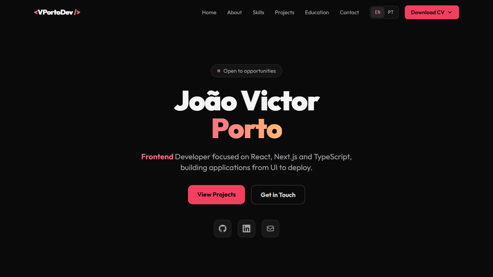

# João Victor Porto | Portfolio



Personal portfolio built with **Next.js 14** and **Tailwind CSS**, deployed on **Vercel**.

**Live:** [portfolio-six-beige-72.vercel.app](https://portfolio-six-beige-72.vercel.app)

## Features

- **English and Portuguese** versions (`/` and `/pt`) with a PT/EN switch in the navbar
- **Bilingual CV download**, offering the PDF in the active language first
- **Dark theme** with a rose on neutral palette
- **Fully responsive**, mobile-first layout
- **SEO**: per-language metadata, `hreflang` alternates and a generated Open Graph image
- **Scroll animations** with Intersection Observer
- **Skills as tags**, grouped by category in tabs
- **Project cards** with featured projects, tech tags and links
- **Fixed navbar** with blur on scroll
- **No heavy dependencies**: no i18n or UI libraries

## Tech Stack

| Layer     | Technology              |
| --------- | ----------------------- |
| Framework | Next.js 14 (App Router) |
| Styling   | Tailwind CSS 3.4        |
| Language  | JavaScript (React 18)   |
| Fonts     | Outfit + JetBrains Mono |
| Deploy    | Vercel                  |

## Running locally

```bash
git clone https://github.com/Jportov/portfolio.git
cd portfolio
npm install
npm run dev
```

Open [http://localhost:3000](http://localhost:3000).

## Project structure

```
portfolio/
├── app/
│   ├── (en)/                  # English routes (default language, served at /)
│   ├── (pt)/                  # Portuguese routes (served at /pt)
│   ├── components/            # HomePage, Navbar, ProjectCard, SkillsSection...
│   ├── data/portfolio.js      # All site content, in English and Portuguese
│   ├── fonts/                 # Outfit files used by the Open Graph image
│   ├── hooks/useReveal.js     # Scroll reveal hook
│   ├── lib/metadata.js        # Per-language SEO metadata
│   ├── globals.css            # Global styles + Tailwind
│   ├── icon.svg               # Favicon
│   └── opengraph-image.jsx    # Link preview image
├── docs/                      # README assets
├── public/                    # Static assets (CV PDFs)
├── tailwind.config.js
├── postcss.config.js
├── next.config.js
└── package.json
```

## Editing content

All visible text lives in [`app/data/portfolio.js`](app/data/portfolio.js). Text that changes with the language is written as `{ en: "...", pt: "..." }`; everything else is shared by both languages.

Each language has its own root layout, so `<html lang>`, the page title, the description and the Open Graph locale follow the active language.

## Sections

- **Hero**: introduction with social links and calls to action
- **About**: professional summary and quick facts
- **Skills**: tags grouped in tabs (Frontend / Testing & Quality / Backend / Tools)
- **Projects**: cards with featured projects, tech tags and links
- **Education**: degrees and additional courses
- **Contact**: email, LinkedIn and phone

## Deploy

The project deploys automatically on Vercel on every push to the `main` branch.

## License

This project is for personal use. Feel free to use it as inspiration, but please do not copy the personal content.

---

Built by [João Victor Porto](https://linkedin.com/in/vportodev)
